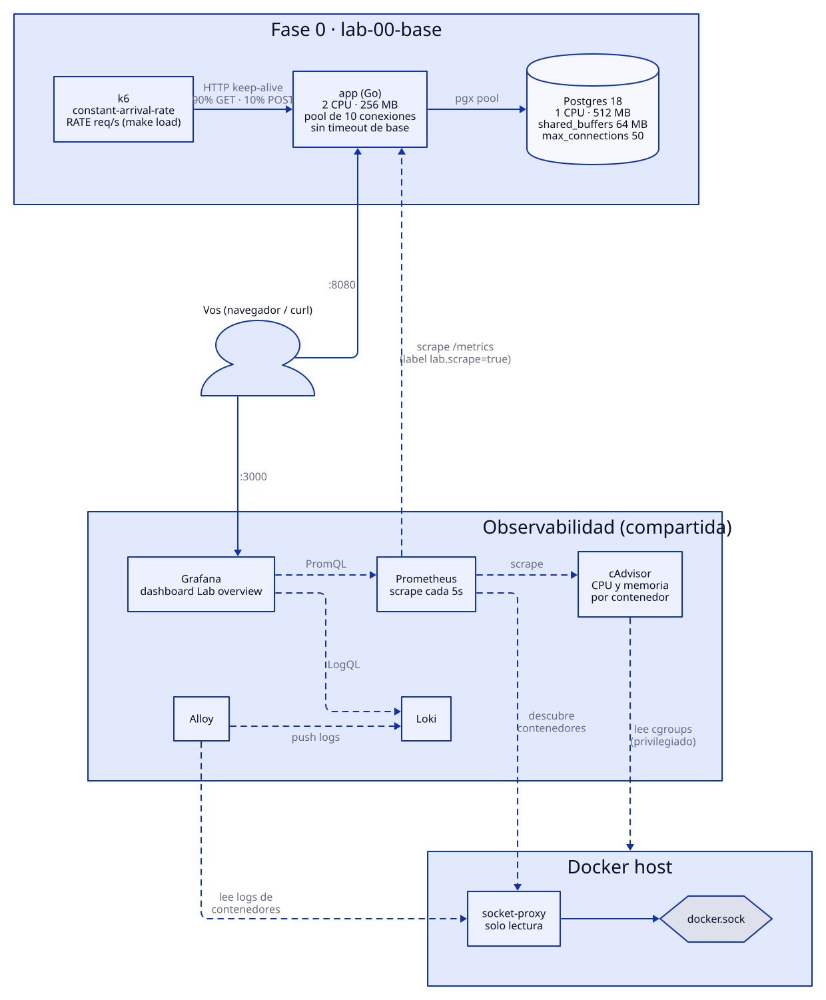
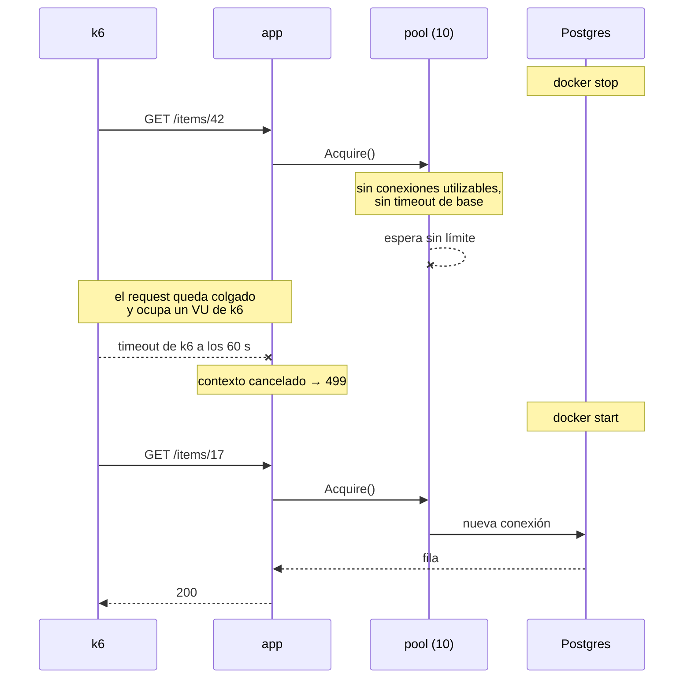

# Fase 0 · Base del laboratorio

Una sola instancia de la app en Go delante de un Postgres, con el stack de
observabilidad compartido y k6 como generador de carga. Es la línea base contra
la que se comparan todas las fases siguientes, y el primer lugar donde se rompe
algo a propósito.



Líneas sólidas: el camino de un request. Punteadas: observabilidad. Fuente en
[`diagrams/architecture.d2`](diagrams/architecture.d2) (`make diagrams`).

## Cómo correrla

```bash
make up                               # observabilidad + Postgres + app
make load RATE=200 DURATION=5m        # k6 a tasa constante (ver load/constant.js)
make down                             # baja todo y conserva los volúmenes
```

| Qué | Dónde |
|---|---|
| Dashboard RED | http://localhost:3000/d/lab-overview |
| App | http://localhost:8080 (`/healthz`, `/readyz`, `/items`, `/slow`) |
| Prometheus | http://localhost:9090 |

El script de k6 usa un modelo abierto (`constant-arrival-rate`): llegan `RATE`
requests por segundo pase lo que pase, 90% `GET /items/{id}` y 10%
`POST /items`. Si el sistema se pone lento, los requests se acumulan en vez de
bajar la carga sin que nadie lo note.

Para empezar con la base vacía: `make down && docker volume rm lab-00-base_postgres-data`.

### Configuración medida

| Componente | Límites y configuración |
|---|---|
| Postgres 18 | 1 CPU, 512 MB, `shared_buffers=64MB`, `max_connections=50` |
| app | 2 CPU, 256 MB, pool de 10 conexiones, **sin timeout de base** (`DB_TIMEOUT=0s`) |
| k6 | hasta 500 VUs; timeout por request de 60 s (el default) |
| Host | Ryzen 5 5600X (6 núcleos / 12 hilos), 32 GB, NVMe; k6 corre en la misma máquina |

Los números de abajo valen para este entorno. Lo que se puede llevar a otro
lado son las formas de las curvas y los mecanismos, no los valores absolutos.

## E1 · Capacidad: ¿qué se satura primero?

**Hipótesis.** Postgres, limitado a 1 CPU, es lo primero que se satura. Con
carga moderada no debería pasar nada.

**Carga.** `make load` subiendo `RATE` de 200 a 28.000 req/s.

**Resultado.**

| RATE pedido | Atendido | p95 (k6) | CPU Postgres | CPU app | `dropped_iterations` |
|---|---|---|---|---|---|
| 200 | 200 | 0,8 ms | ~0 | ~0 | 0 |
| 3.000 | 3.000 | 0,9 ms | 0,15 | 0,2 | 13 |
| 10.000 | 9.960 | 1,2 ms | 0,62 | 0,48 | 1.154 |
| 15.000 | 14.910 | 6,8 ms | 0,88 | 1,0 | 9.467 |
| 20.000 | 15.600 | 47 ms | 0,92 | 0,92 | 790.856 |
| 28.000 | 15.570 | 62 ms | **1,00** | 0,90 | 1.489.803 |

- **El techo es ~15,6k req/s y lo pone la CPU de Postgres.** A partir de 20k
  está al 100% y el kernel lo frena (`container_cpu_cfs_throttled_seconds_total`
  sube a ~1,5 s/s). La app nunca pasa de 1 core de sus 2.
- **La cola se arma en el pool de la app.** A 20k, el 94% de los pedidos de
  conexión encontró el pool lleno y esperó, 21 ms en promedio. Casi toda la
  latencia es esa espera, no las queries.
- **Pasado el techo, más carga solo agrega latencia.** De 20k a 28k el
  throughput no se mueve y el p50 del server pasa de 17 a 21 ms.
- **Los VUs de k6 cumplen la ley de Little** (concurrencia = throughput ×
  latencia): 15,6k req/s × 31 ms ≈ 480 VUs, contra un tope de 500. Cuando se
  acaban, k6 descarta iteraciones (`dropped_iterations`).
- **El host no fue el límite:** todos los contenedores juntos usaron ~3,8 de
  12 hilos.

**En qué me equivoqué.** Esperaba ver la saturación a "carga moderada". Leer
y escribir por primary key es tan barato que, con 1 CPU, Postgres aguanta
~15k req/s, y a 3k está al 15%.

**Lo que no esperaba.**

- **Cero errores con el sistema saturado.** Sin timeouts nada falla: todo se
  vuelve más lento. Un cliente real con timeout se iría, y eso recién se vería
  como 499.
- **Los thresholds de k6 quedaron en ✓** (`p(95)<100ms` con p95 = 62 ms). La
  señal real fue `dropped_iterations`.

## E2 · Tamaño del pool de conexiones

**Hipótesis.** La regla clásica (wiki de PostgreSQL, HikariCP) es
`conexiones = cores × 2 + discos efectivos`, contando los cores **de Postgres**.
Con 1 CPU y los datos en memoria da ~3. Como el techo es la CPU de Postgres, el
throughput no debería cambiar con el tamaño del pool.

**Carga.** `RATE=20000` (por encima del techo, con k6 al tope de 500 VUs en
todas las corridas), cambiando `DB_MAX_CONNS` en `compose.yaml`.

**Resultado.**

| Pool | Atendido | CPU Postgres | Throttling | Esperaron conexión | Espera media | p50 / p99 | Memoria Postgres |
|---|---|---|---|---|---|---|---|
| 3 | 13,0k | 0,86 | 0,01 s/s | 100% | 38 ms | 38 / 82 ms | 37 MiB |
| 5 | 14,5k | 0,99 | 0,40 s/s | 100% | 33 ms | 36 / 88 ms | 42 MiB |
| 10 (día 1) | 15,6k | 0,92 | 1,54 s/s | 94% | 21 ms | 17 / 78 ms | 72 MiB |
| 10 (día 2) | 13,9k | 0,91 | 0,98 s/s | 100% | 32 ms | 28 / 98 ms | 66 MiB |
| 50 | 14,9k | 1,00 | 4,29 s/s | 73% | 22 ms | 9,5 / 91 ms | 141 MiB |

- **Con 3 conexiones, el pool pasa a ser el cuello de botella:** Postgres queda
  con CPU libre (0,86, sin frenar). Cada query pasa parte de su tiempo afuera de
  Postgres (ida y vuelta por la red de Docker, trabajo de la app), y con 3
  conexiones esos huecos no se llegan a cubrir.
- **Entre 5 y 50 la diferencia cae dentro del ruido.** La misma configuración
  (pool 10) dio 15,6k un día y 13,9k otro.
- **Pool 50 tiene costos medibles:** el doble de memoria (cada conexión es un
  proceso de Postgres), casi el triple de throttling (50 procesos peleando por
  1 CPU) y el peor p99. La mediana mejora porque uno de cada cuatro requests
  consigue conexión al instante, pero el throughput no sube.
- **Pool 50 = `max_connections` 50: la app se quedó con todas.** Después de la
  corrida ni `psql` podía entrar (`FATAL: sorry, too many clients already`). El
  pool mantiene abiertas las conexiones ociosas.

**En qué me equivoqué.** Predije que con 3 el throughput no iba a cambiar, y
cambió (-17%). Después afirmé que el óptimo era 10 con una sola corrida por
punto, y repetirla mostró que la diferencia entre 5, 10 y 50 no se sostiene.

**Conclusión.** La fórmula es un punto de partida que acá se queda corto, porque
no cuenta el tiempo que la conexión pasa fuera de la base. Para elegir el
tamaño hay que medir, y lo importante pasa en los extremos: con muy pocas
conexiones la base queda ociosa, y con muchas cuestan memoria y latencia de
cola y pueden agotar `max_connections`.

## E3 · Caída de Postgres sin timeout de base

**Hipótesis.** Al tirar Postgres, los requests no fallan: se cuelgan. Los
in-flight y las goroutines crecen, `/readyz` da 503 y, al volver Postgres, todo
se recupera solo. Si la caída dura más de 60 s, k6 corta los requests y la app
los registra como 499.

**Carga y falla.** `make load RATE=200 DURATION=3m`. Al minuto,
`docker stop lab-00-base-postgres-1`. 70 s después, `docker start`.

**Resultado.**

| Momento | In-flight | Goroutines | Respuestas OK/s | Qué pasa |
|---|---|---|---|---|
| Antes | 1 | 61 | 200 | normal |
| Corte (+0 s) | — | — | — | 11 errores 500: las queries en curso y las conexiones nuevas reciben `the database system is shutting down` |
| +5 s | 249 | 533 | 109 | los requests empiezan a colgarse |
| +10 s → +65 s | **~500** | **~1.040** | **0** | k6 llegó a su tope de 500 VUs; `/readyz` da 503 durante toda la caída |
| +60 s | — | — | — | k6 corta por timeout los requests colgados más viejos: **458 timeouts** |
| +70 s (vuelve Postgres) | 1 | 516 | 200 en < 5 s | recuperación sola, sin intervención |

Totales: k6 registró **518 fallas** (2,3%): **458 timeouts** de k6, que la app
contó exactamente como **458 respuestas 499**, y **60 errores 500**: 11 en el
instante del corte y 49 durante la caída (~1 por segundo), con
`no such host` porque el DNS de Docker ya no resuelve `postgres`. Además, k6 descartó 13.228
iteraciones por no tener VUs libres.



**Lo que se confirmó.** Sin timeout de base, una dependencia caída no produce
errores rápidos: produce requests colgados que se acumulan hasta el límite del
cliente. Y la falla se ve del lado del cliente (timeouts) antes que en las
métricas de error del servidor: durante 60 s el panel de 5xx está casi vacío.

**Lo que no esperaba.**

- **Las goroutines bajaron a la mitad y no a cero después de la recuperación**
  (516 durante casi un minuto). Son las conexiones keep-alive de los 500 VUs
  de k6: `net/http` mantiene una goroutine por conexión abierta. Bajaron a 10
  cuando k6 terminó.
- **Durante la caída, `/readyz` tardaba 2 s en contestar el 503**: espera su
  propio timeout contra la base. Un load balancer con un health check corto
  (por ejemplo 1 s) lo vería como timeout, no como 503.

**Pregunta abierta.** Durante la caída el pool reportaba 10 conexiones totales
y 0 en uso, mientras ~500 requests esperaban. No medí qué estaban haciendo
exactamente esas 10 (reintentos de conexión que no fallan rápido, por ejemplo).
Vale la pena investigarlo cuando se agregue el timeout de base.

## Trampas de medición

Aparecieron en esta fase y van a volver a aparecer en todas:

1. **El generador de carga también se satura.** curl sin keep-alive a ~1.000
   req/s agota los ~28k puertos efímeros del cliente (cada conexión queda 60 s
   en `TIME_WAIT`) y da miles de `000` / `connection reset` que no son culpa
   del sistema. Con keep-alive dieron 40.000 de 40.000 OK. k6 usa keep-alive
   por defecto.
2. **Una corrida no alcanza.** La misma configuración varió ~±7% entre días.
   En una de las corridas, autovacuum se ejecutó en el medio y le sacó CPU a las
   queries.
3. **`increase()` de Prometheus subestima los contadores que nacen en la
   ventana.** El contador de 499 no existía antes de la caída: `increase()` dio
   273, y el valor real del contador era 458. Para totales exactos, restar el
   valor crudo del contador antes y después.
4. **Series de una instancia anterior.** Después de recrear la app, Prometheus
   muestra un rato las series de la IP vieja. Si una consulta toma el primer
   resultado, puede leer la instancia equivocada.
5. **k6 corre en la misma máquina.** Hay que confirmar que el host no esté al
   tope (`docker stats` o la CPU de todos los contenedores) antes de culpar al
   sistema.

## Conclusiones y mitigaciones

Ninguna está aplicada todavía: son el punto de partida de las fases siguientes.

1. **Timeout de base.** Convierte "colgado indefinidamente" en "error rápido",
   libera la concurrencia y hace visible la falla en las métricas del servidor.
   Implica elegir un valor y decidir qué se le responde al cliente (503/504).
2. **Dimensionar el pool midiendo,** y que pool × réplicas quede bastante por
   debajo de `max_connections`, con margen para admin, monitoreo y
   migraciones. Con muchas réplicas hace falta un pooler (PgBouncer, fase 2).
3. **¿`/readyz` debería depender de la base?** Si depende, una caída de
   Postgres deja a todas las réplicas fuera del load balancer a la vez. Si no,
   el load balancer sigue mandando tráfico a instancias que no pueden
   atenderlo. Es la entrada a la fase 1.
4. **Alertar por saturación, no solo por errores.** Un threshold de
   `dropped_iterations` en k6, o alertas sobre espera en el pool e in-flight,
   detectan lo que el p95 y el % de errores no ven.

## Equivalentes en AWS

| Lab | AWS |
|---|---|
| Postgres | RDS for PostgreSQL / Aurora (el límite de conexiones depende del tamaño de instancia; RDS Proxy cumple el rol de pooler) |
| Prometheus y Grafana | Amazon Managed Service for Prometheus, Amazon Managed Grafana / CloudWatch |
| Loki | CloudWatch Logs |
| cAdvisor | CloudWatch Container Insights |
| k6 | Grafana Cloud k6 / Distributed Load Testing on AWS |

## Qué sigue

**Fase 1: escalado horizontal y load balancing.** Tres réplicas de la app
detrás de un load balancer. Preguntas que deja esta fase:

- ¿Qué hace el load balancer cuando las tres réplicas dan 503 al mismo tiempo
  porque se cayó la base que comparten?
- ¿Escalar la app sube el techo de 15,6k req/s, si el cuello de botella es
  Postgres?
- Tres réplicas con un pool de 10 son 30 conexiones contra `max_connections`
  50: ¿cuántas réplicas entran antes de quedarse sin conexiones?
